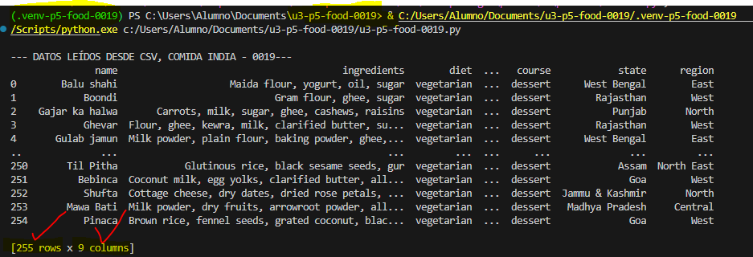
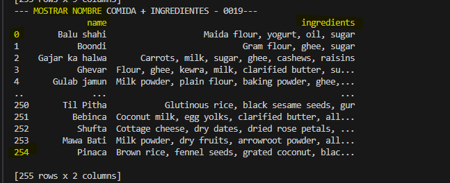
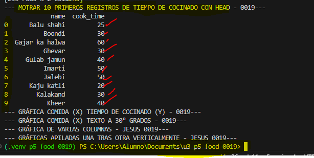
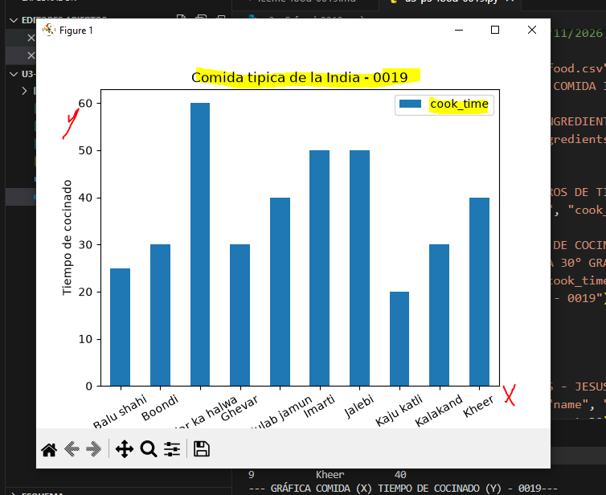
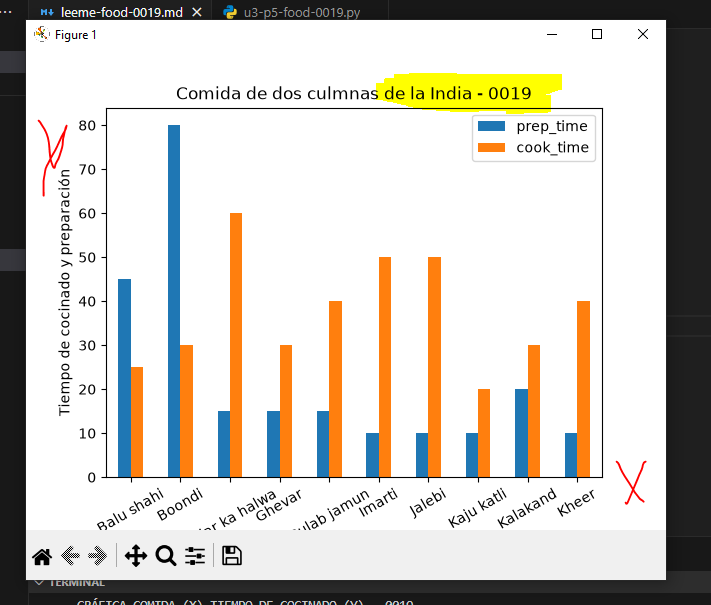
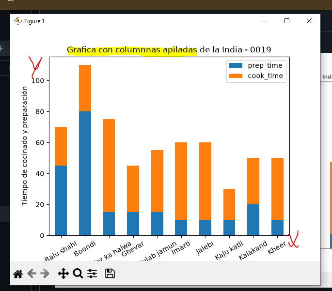

# Analisis exploratorio de datos
# comida pais India
# Jesus Arriaga 0019
# Importando datos de CSV comida de India - 0019 ----

# Mostrar Nombre Comida + Ingredentes

# Mostrar tiempo de cocinado----

## Creación de gráficas

## Grafica de varias columnas

## Graficas apiladas verticalmente
